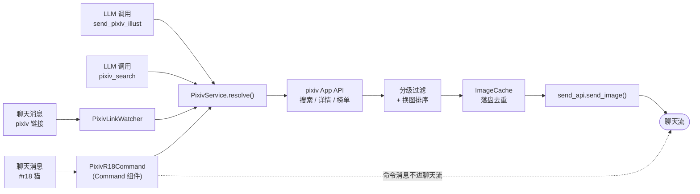

<div align="center">

# send-pixiv

**让 Neo-MoFox 的 bot 会发 Pixiv 图 —— 丢个链接、下条指令，或者干脆让它自己找。**

[](LICENSE)
[](https://github.com/elysiamsia/send-pixiv/releases)
[](https://github.com/elysiamsia/send-pixiv/commits/main)
[](https://github.com/elysiamsia/send-pixiv/stargazers)
[](https://www.python.org/)
[](https://github.com/MoFox-Studio/Neo-MoFox)
[](tests/)
[](pyproject.toml)

[简体中文](README.md) · [English](README.en.md) · [设计文档](docs/design.md) · [配置手册](docs/config.md)

</div>

---

## 目录

- [这是什么](#这是什么)
- [核心特性](#核心特性)
- [快速开始](#快速开始)
- [使用示例](#使用示例)
- [工作原理](#工作原理)
- [配置](#配置)
- [常见问题](#常见问题)
- [大陆网络怎么配](#大陆网络怎么配)
- [开发](#开发)
- [贡献](#贡献)
- [许可证](#许可证)
- [致谢](#致谢)

---

## 这是什么

**Neo-MoFox 的 Pixiv 发图插件。** 它解决的是「机器人想发张 Pixiv 的图，但没一个好用的插件」这件事：

贴一个 Pixiv 链接进去就能发图；想找图可以发指令，也可以让 bot 自己决定；内置分级过滤，R-18 只在允许的会话里出现；**零第三方依赖**，只用标准库 + bot 自带的 httpx。

> **不需要**额外部署 PixivFlow 之类的 Node 服务，插件自带一套 Pixiv App API 客户端。

---

## 核心特性

| | 特性 | 说明 |
| --- | --- | --- |
| 🔗 | **链接即发图** | 消息里出现 `pixiv.net/artworks/...` 自动下载发送，同一作品 5 分钟内不重复 |
| 💬 | **聊天指令** | `#r18 猫` / `#pixiv 风景` 直接搜图，**绕开 LLM**，不会被模型"我不好查这个"挡掉 |
| 🤖 | **LLM 工具** | 提供 Action 与 Tool，bot 能自己找图、先查后发 |
| 🔞 | **分级管控** | 按会话控制 `safe` / `r18` / `all`，超限**明确拒绝**而不是静默降级 |
| 🛡️ | **白名单** | 允许/禁止名单**直接填群号或 QQ 号**，不用去翻哈希 |
| 🔄 | **自动换图** | 同一个关键词每次发不同的图，一轮发完自动轮换 |
| 🖼️ | **三级画质回退** | `master1200` → `large` → `original`，某一档不存在时自动降级 |
| 🌏 | **图片直连** | 大陆网络下图片可绕过 SNI 封锁直连，省代理流量（[原理](docs/design.md)） |
| 🪶 | **零依赖** | 不引入任何第三方包，只用 bot 自带的 httpx |

---

## 快速开始

### 前置条件

- **Neo-MoFox** 已跑起来（本插件在 bot 侧加载，不需要单独进程）
- **Python 3.11+**（bot 自带的 venv 即可）
- 一个 **Pixiv 账号**（用于拿 refresh_token）
- 能访问 Pixiv 的网络（大陆用户见[大陆网络怎么配](#大陆网络怎么配)）

### 安装

**方式一：插件市场（推荐）**

在 bot 的 WebUI 插件市场里搜索 `send-pixiv`，订阅后自动安装并跟随更新。

**方式二：手动装 .mfp**

从 [Releases](https://github.com/elysiamsia/send-pixiv/releases) 下载 `send-pixiv-x.y.z.mfp`，
放进 bot 的 `plugins/` 目录，重启 bot。

**方式三：从源码**

```bash
git clone https://github.com/elysiamsia/send-pixiv.git
cd send-pixiv

# 直接拷进 bot 的插件目录（推荐，能带上 docs/ 和 scripts/）
python scripts/install_to_bot.py "D:/path/to/bot/neo-mofox"

# 或者打成 .mfp
python scripts/build_mfp.py
```

> ⚠️ **Neo-MoFox 的插件与配置都不热加载，装完必须重启 bot。**

### 配置凭据

> **先看这里**：拿 refresh_token 要用本仓库的 `scripts/pixiv_login.py`。
> 如果你是通过**插件市场 / 手动装 .mfp** 安装的，bot 的 `plugins/` 目录里
> **没有** `scripts/`（打包时刻意排除了它）——请把仓库 clone 下来（或下载单个脚本），
> 在仓库目录里跑下面的命令即可，脚本会自己把 token 写进插件的数据目录。

跑一次浏览器授权，拿到 refresh_token：

```bash
git clone https://github.com/elysiamsia/send-pixiv.git && cd send-pixiv
python scripts/pixiv_login.py --proxy http://127.0.0.1:7890   # 不需要代理就去掉 --proxy
```

它会打印一个 Pixiv 登录地址 → 在浏览器里登录 → 页面最后会跳到
`pixiv://account/login?code=...`，**浏览器打不开这种协议没关系，把地址栏整条 URL 复制回终端**即可。

脚本会拿 code 换令牌并写进 `data/send-pixiv/token.json`，插件运行期直接用这份。

> 拿到的 token 也可以手动填进 `config/plugins/send-pixiv/config.toml` 的
> `pixiv.refresh_token`——两种方式都行，插件优先用 `token.json` 里那份（因为
> pixiv 刷新时会**轮换** token，新值落在那里）。

> **安全提示**：refresh_token 等同于账号凭据。它既在 `token.json` 里、也可能被你填进
> `config.toml`——这两个文件都别提交进仓库、别发到群里。

---

## 使用示例

### 1. 贴链接就发图

```text
用户：https://www.pixiv.net/artworks/125992443
bot：[图片] 🎨 作品名 / 👤 作者 / 🔗 链接
```

支持作品页、App 深链（`pixiv://illusts/...`）和作者主页（会取该作者的最新作品）。

### 2. 聊天指令（绕开 LLM）

```text
用户：#r18 猫
bot：[图片] 🎨 ...
```

指令实现为框架原生的 **Command 组件**，命令消息**不会进聊天流**——所以模型看不到它，
既不会被"我不方便查找这类内容"挡掉，也不会在插件发完图之后再插一句拒绝。

`#r18` 仍受分级约束：会话没开 R-18 时会**明确回复**原因，不会静默降级成全年龄。

### 3. 让 bot 自己找

```text
用户：来点猫娘的图
bot：[图片] 🎨 ...
```

### 4. 先查后发

```text
用户：pixiv 上有什么好看的风景图
bot：（调用 pixiv_search）列出候选 → 用户挑一个 → bot 再发
```

---

## 工作原理



设计取舍、框架机制与踩过的坑都记在 **[docs/design.md](docs/design.md)**。

---

## 配置

配置文件在 `config/plugins/send-pixiv/config.toml`，**全部配置项见 [docs/config.md](docs/config.md)**。

最常用的几项：

```toml
[plugin]
default_rating = "safe"            # safe / r18 / all
allowed_streams = ["123456789"]    # 白名单：直接填群号或 QQ 号，留空=不限制
r18_streams = ["123456789"]        # 这些会话允许 R-18

[pixiv]
proxy = "http://127.0.0.1:7890"    # 大陆用户必填，见下节

[download]
direct_image = true                # 图片走直连（连真实 IP + 不发 SNI）

[search]
rotate = true                      # 同一个关键词每次换一批图

[trigger]
enabled = true                     # 响应 #r18 / #pixiv 指令
```

---

## 常见问题

<details>
<summary><b>发不出图 / 一张都没发出去</b></summary>

按顺序排查：

1. **凭据**：`data/send-pixiv/token.json` 在不在？配置里的 `refresh_token` 填了没？
   跑 `python scripts/check_network.py` 看 API 通不通。
2. **分级**：会话没开 R-18 却发 R-18 内容会被过滤掉。把群号加进 `plugin.r18_streams`。
3. **体积**：超过 `download.max_image_mb` 的图会被跳过，调大或改用 `large` 档。
4. **日志**：`logs/` 里搜 `send-pixiv`，每个组件有自己的 logger（`send-pixiv.command` /
   `send-pixiv.service` / `send-pixiv.action`）。

</details>

<details>
<summary><b>bot 说"这类内容我不查"</b></summary>

这是 **LLM 自己拒绝**的，不是插件的问题——模型看不到指令消息、或者它主动婉拒了。

用**聊天指令**（`#r18 猫`）就不会：命令消息不进聊天流，模型根本没机会插话。

</details>

<details>
<summary><b>同一个关键词老是发同样的图</b></summary>

检查 `search.rotate` 是不是被关了。默认开着，插件会把候选排成
「没发过的优先、发过的按最早发送在后」——连续发 `#r18 猫` 每次都是新图，
一轮发完之后自动从头轮换。

</details>

<details>
<summary><b>插件加载了但指令没反应</b></summary>

看日志里这两行：

```text
开始注册插件 'send-pixiv' 的 6 个组件     ← 应该是 6
设置命令前缀: ['/', '#']                  ← 插件追加了 #
```

如果组件数不对，说明 `get_components()` 没列全（仓库自带
`python scripts/check_manifest.py` 静态校验，能提前发现这类问题）。

</details>

<details>
<summary><b>能发动图（ugoira）吗？</b></summary>

目前不能，`exclude_ugoira` 默认跳过动图。Pixiv 的动图是 zip 包，
需要合成 GIF 或 MP4 才能发，欢迎 PR。

</details>

---

## 大陆网络怎么配

> **一句话**：大陆网络下**没有代理就用不了这个插件**——pixiv 的 API 域名被 SNI 封锁，
> 搜索、作品详情、令牌刷新全都走不了。下面说的「图片直连」只是**省流量的优化**，
> 救不了 API。

Pixiv 在大陆是「DNS 投毒 + SNI 阻断」两道锁，**但不同域名处境不一样**（实测结论）：

| 域名 | 用途 | 能不能直连 |
| --- | --- | --- |
| `app-api.pixiv.net` | 搜索 / 作品详情 | ❌ **必须走代理** |
| `oauth.secure.pixiv.net` | 刷新令牌 | ❌ **必须走代理** |
| `i.pximg.net` | 图片下载 | ✅ **可以直连** |

原因是 GFW 按**域名清单**拦 TLS 的 SNI：那两个 API 域名在清单里，换 IP、改大小写、
加尾点、TCP 分片**实测全部无效**；而图片域名不在清单里，连它的真实 IP 且**不发 SNI**
就能正常下到图。

所以推荐的配法是——**代理照开，图片走直连**：

```toml
[pixiv]
proxy = "http://127.0.0.1:7890"   # API 必须靠它

[download]
direct_image = true                # 图片不走代理，省流量也更快
```

先跑一次自检，看清当前环境哪条路通：

```bash
python scripts/check_network.py --proxy http://127.0.0.1:7890
```

完整的封锁机制分析与实测矩阵见 [docs/design.md 第 9 节](docs/design.md)。

---

## 开发

```bash
# 静态校验（组件注册、logger 用法、配置节声明、associated_types…）
python scripts/check_manifest.py

# 单元测试（不需要 bot 环境，自带框架替身）
cd tests && python -m unittest discover -s . -p "test_*.py"

# 打包
python scripts/build_mfp.py

# 网络自检
python scripts/check_network.py --proxy http://127.0.0.1:7890
```

仓库结构：

```text
send-pixiv/
├── plugin.py            插件入口，get_components() 是注册真源
├── config.py            配置模型（每个节必须"类 + 字段"两件套）
├── manifest.json        市场元数据
├── core/                纯逻辑：API 客户端 / 链接解析 / 分级 / 缓存 / 不发 SNI 的 TLS
├── services/            业务编排：检索 → 过滤 → 下载 → 发送
├── commands/            Command 组件（#r18 / #pixiv）
├── actions/ tools/      LLM 侧入口
├── handlers/            EventHandler（链接自动解析）
├── docs/                设计文档与配置手册
├── scripts/             校验 / 打包 / 装机 / 登录 / 网络自检
└── tests/               161 个单元测试（含离线框架替身）
```

---

## 贡献

欢迎 Issue 和 PR。提交前请：

1. 跑一遍 `python scripts/check_manifest.py` 和单元测试；
2. 新增组件记得写进 `plugin.py` 的 `get_components()`（**这是注册真源**，
   光有类文件不会生效）；
3. 配置项变更记得同步 `docs/config.md`。

详见 [CONTRIBUTING.md](CONTRIBUTING.md)。

---

## 许可证

[GPL-3.0](LICENSE) © elysiamsia

---

## 致谢

- [Neo-MoFox](https://github.com/MoFox-Studio/Neo-MoFox) —— 插件框架
- [PixEz](https://github.com/CeuiLiSA/PixEz-flutter) —— 图片直连的思路来自它的网络层
- 所有 [贡献者](https://github.com/elysiamsia/send-pixiv/graphs/contributors)
